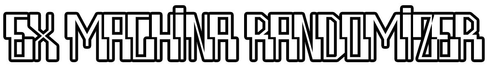

<div align="center">
    <a href="https://github.com/zatinu322/Var-Mod-Trash-Machina/releases/tag/v1.3-beta"></a>
    
    <a href="https://github.com/DeusExMachinaTeam/EM-CommunityPatch"></a>
    <a href="https://github.com/DeusExMachinaTeam/EM-CommunityPatch"></a>
    
</div>

***

<div align="center">
    <h3>Контакты автора</h3>
      <a href="https://www.youtube.com/@pavlikrpg"></a>
      <a href="https://www.twitch.tv/pavlikrpg"></a>
      <a href="https://t.me/pavlikrpg"></a>
      <a href="https://discord.gg/sPrGBP9aFd"></a>
      <a href="https://vk.ru/pavlikrpg"></a>
</div>

***
Ex Machina Randomizer - модификация, также известная как TrashMachina, Ex Randomina и VarMod (Various Modification), является первой и, пока что, единственной модификацией для Ex Machina, вносящей в геймплей игры элемент случайности.

Для достижения подобного эффекта была создана специальная программа, которая в зависимости от ваших настроек рандомизирует тот или иной геймплейный элемент.

### Системные требования

- Windows 10 и выше
- Ex Machina v1.02 (**русская** steam-лицензия)

## Установка

1. Скачайте [последний релиз](https://github.com/zatinu322/Var-Mod-Trash-Machina/releases/tag/v1.3-beta) исходного кода и **обязательно** распакуйте его в любое удобное для вас место.
2. Запустите файл `randomizer-v*.exe`.

**Внимание!** Запуск из исполняемого файла пока находится на стадии тестирования. Если у вас не работает данный способ, попробуйте способ из раздела `Запуск из source кода`.

Помимо прочего, исполняемый файл может вызвать ложные срабатывания антивируса, т.к. он скомпилирован с помощью `nuitka` из Python кода, который побайтово патчит исполняемый файл игры, копирует и удаляет файлы, а также меняет содержимое текстовых файлов. Это алгоритм работы рандомайзера. Если вы хотите сами скомпилировать исполняемый файл из исходника, то рекомендую обратить внимание на скрипт [build_exe.ps1](https://github.com/zatinu322/Var-Mod-Trash-Machina/blob/main/build_exe.ps1).

## Использование

<details><summary>Пример настройки рандомизации</summary></details>

1. Переключите язык на тот, который вам более удобен.
2. Раскройте контейнер с настройками рандомизации и выберите те аспекты игры, которые хотите рандомизировать.
3. Укажите путь к вашей папке с игрой.
4. Укажите версию вашей игры.
5. Начните рандомизацию.

**ВНИМАНИЕ!** Рандомизация **НЕОБРАТИМА!** 

Для того, чтобы вернуть игру в исходное состояние, вам необходимо заново её установить или восстановить из бэкапа.

## Запуск из source кода

Пока что рандомайзер существует только в виде набора файлов с исходным кодом, исполняемый файл будет собран чуть позже.

1. Установите [Python v3.12.1](https://www.python.org/downloads/), а потом все необходимые зависимости с помощью `pip`:
    ```sh
    pip install -r requirements.txt
    ```
    Или с помощью [Poetry](https://python-poetry.org/docs/):

    ```sh
    poetry install
    ```
2. Скачайте [последний релиз](https://github.com/zatinu322/Var-Mod-Trash-Machina/releases/tag/v1.3-beta) исходного кода и **обязательно** распакуйте его в любое удобное для вас место.

3. Запустите рандомайзер из корневой папки:
    ```
    python src/main.py
    ```
    Или, если вы воспользовались [Poetry](https://python-poetry.org/docs/):
    ```sh
    poetry run python src/main.py
    ```

## Особые благодарности

- [Seel](https://github.com/Zvetkov) за информацию по ассетам движка и неоценимую помощь в разработке.
- [ThePlain](https://github.com/ThePlain) за скрипт рандомизации ландшафта.

## Мои другие проекты

<div>
  <a href="https://github.com/zatinu322/ImprovedStoryline"></a><br>
  <a href="https://github.com/zatinu322/stream_builds"></a><br>
  <a href="https://github.com/zatinu322/hta_kazakh_autotranslation"></a><br>
  <a href="https://github.com/zatinu322/demo_r1m4"></a>
</div>